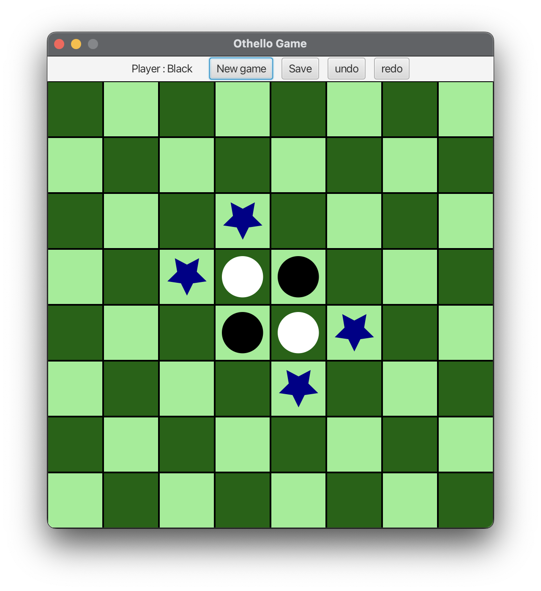

# Board Game Library - Othello

Une bibliothèque de jeux de plateau développée en Java avec JavaFX, implémentant le jeu Othello.


## Table des matières

- [Aperçu](#aperçu)
- [Fonctionnalités](#fonctionnalités)
- [Prérequis](#prérequis)
- [Installation](#installation)
- [Utilisation](#utilisation)
- [Structure du projet](#structure-du-projet)
- [Tests](#tests)
- [Développement](#développement)
- [Contribution](#contribution)

## Aperçu

Ce projet est une implémentation complète du jeu Othello (aussi connu sous le nom de Reversi) utilisant une architecture modulaire avec JavaFX pour l'interface graphique. Le jeu propose plusieurs modes de jeu et fonctionnalités avancées.

### Capture d'écran



## Fonctionnalités

- **Jeu Othello complet** avec règles officielles
- **Mode multijoueur** (Humain vs Humain)
- **Mode IA** (Humain vs Intelligence Artificielle)
- **Sauvegarde/Chargement** de parties
- **Annuler/Refaire** les coups
- **Interface graphique moderne** avec JavaFX
- **Suivi des scores** en temps réel
- **Interface intuitive** et responsive
- **Historique des parties** avec système d'undo/redo
- **Gestion automatique des passes** lorsqu'un joueur ne peut pas jouer

## Prérequis

Avant de commencer, assurez-vous d'avoir installé :

- **Java 25** (version preview recommandée)
- **Gradle 8.x** ou utilisez le wrapper inclus
- **Git** pour le clonage du projet

### Vérification des prérequis

## Installation

### 1. Cloner le projet
```bash
 git clone https://etulab.univ-amu.fr/yanis_liassine/board-game-library-template.git cd board-game-library
```
### 2. Compiler le projet
```bash
./gradlew build
```
## Utilisation

### Lancement rapide
```bash
make run
```
### Autres commandes utiles

# Créer un JAR exécutable
```bash
make jar
```
# Créer un fat JAR (avec dépendances)
```bash
make shadowjar
```
# Nettoyer les fichiers de build
```bash
make clean
```

## Comment jouer

1. **Démarrez l'application** avec `make run`
2. **Choisissez le mode de jeu** :
    - Nouvelle partie
    - Charger une partie sauvegardée
3. **Sélectionnez le type de partie** :
    - Humain vs Humain
    - Humain vs IA (avec choix de stratégie)
4. **Jouez** en cliquant sur les cases valides
5. **Utilisez les boutons** pour :
    - Sauvegarder la partie
    - Annuler/Refaire des coups
    - Recommencer une nouvelle partie

### Règles d'Othello

- Placez vos pions pour encadrer les pions adverses
- Les pions encadrés changent de couleur
- Le joueur qui ne peut pas jouer passe son tour automatiquement
- La partie se termine quand le plateau est plein ou aucun joueur ne peut jouer
- Le gagnant est celui qui a le plus de pions de sa couleur

### Composants principaux

- **GameManager** : Gère la logique d'une partie complète
- **Othello** : Implémente les règles du jeu Othello
- **Grid** : Représente le plateau de jeu 8x8
- **SaveFile** : Gère la persistance des parties
- **GameHistory** : Permet l'annulation/restauration des coups
- **BoardGameCl** : Contrôleur principal reliant la vue et le modèle

## Tests

### Lancer tous les tests
```bash
bash make test
```

### Générer un rapport de couverture
```bash
make coverage
```
Le rapport sera disponible dans `build/jacocoHtml/index.html`

### Tests disponibles

- Tests unitaires des contrôleurs
- Tests de l'interface graphique
- Tests des algorithmes de jeu
- Tests de sauvegarde/chargement
- Tests de l'historique des parties

## Développement

### Architecture

Le projet suit une architecture MVC (Model-View-Controller) avec séparation claire des responsabilités :

- **Model** : Logique métier du jeu Othello (GameManager, Grid, Player)
- **View** : Interface graphique JavaFX
- **Controller** : Pont entre la logique et l'affichage (BoardGameCl)

### Services métier

- **GameManager** : Orchestration générale d'une partie
- **Othello** : Algorithmes et règles du jeu
- **SaveFile** : Sérialisation/désérialisation des parties
- **GameHistory** : Gestion de l'historique avec undo/redo

### Configuration de développement

1. **IDE recommandé** : IntelliJ IDEA
2. **Style de code** : Conventions Java standard
3. **Version Java** : 25 (preview features activées)

### Commandes de développement

### Contribution
- Yanis LIASSINE
- Said TOUMERT
- Abdelaziz MOHANDI
- Meriem SLIMANI
- Anis YAHIA